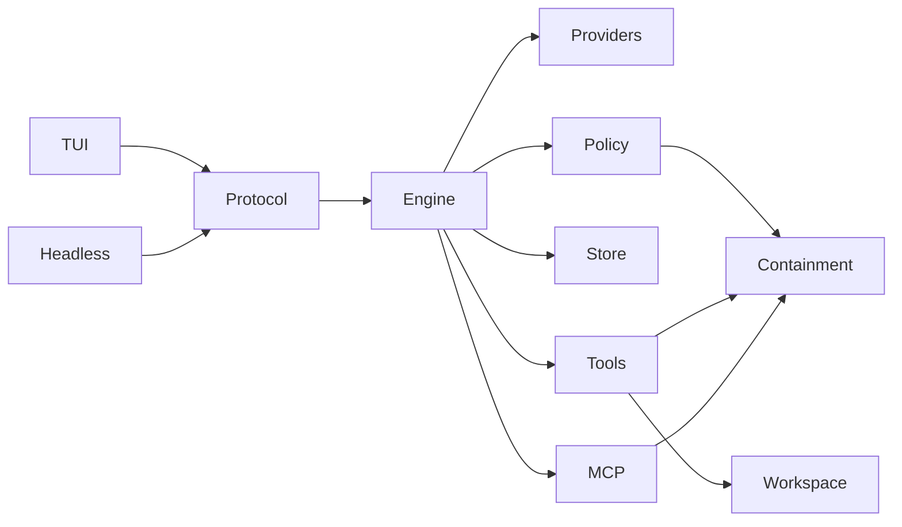

# Mocha architecture and build plan

Revision 7, November 14, 2026. Confirmed build baseline aligned with [PRD revision 5](02-prd.md). Product choices are confirmed in the interview. The maintainer confirmed shared understanding of the handoff on November 14, 2026. All mechanisms and guards below are proposed until implementation evidence exists. Earlier accepted-revision and active-guard claims were not supported by this checkout and are withdrawn.

## Runtime shape

One static Linux executable contains the engine and clients. TUI and headless clients exchange versioned requests/events over bounded in-process channels. A later daemon can replace the transport, but is outside the MVP. Neither client calls engine internals.

The user authorizes actions. Model output, project instructions, tool output, and MCP hints cannot grant authority. Built-in file access and host HTTP use their own policy boundaries. Shell descendants and local MCP additionally require tested OS containment. Remote services are outside local OS containment.

## Module ownership

Create modules as their slices need them. Nine runtime libraries, one binary package, and an xtask package are the target layout, not existing files.

| Library/package | Responsibility | Internal dependencies |
| --- | --- | --- |
| mocha-core | IDs, pure IR, config values/validation, typed errors, redaction transforms | None |
| mocha-proto | Requests/events and versioned schemas | core |
| mocha-store | Durable records, writer ownership, migrations, spill, checkpoints | core |
| mocha-llm | Four API-family profiles, mock provider, stream parsing, discovery, auth resolution | core |
| mocha-policy | Authorization, trust, taint rules, command analysis, containment setup | core |
| mocha-tools | Built-ins, read ledger, evidence, coordinated mutation | core, policy |
| mocha-mcp | Versioned MCP tool client and resource-scoped auth | core, policy |
| mocha-engine | Turn state, context, budgets, queues, dispatch ordering | core, proto, store, llm, policy, tools, mcp |
| mocha-tui | Widgets, rendering, keyboard and terminal lifecycle | core, proto |
| mocha-code binary | CLI, headless protocol client, composition root, doctor | Needed libraries for composition only |
| xtask | Build, evidence, benchmark, and release automation | No runtime ownership |

Core has no IO or async runtime. The binary composition root constructs engine dependencies and gives protocol handles to clients. Its headless handlers cannot bypass the protocol. Enforce the explicit graph, including the composition exception, with cargo metadata and source-level dependency checks.

## Normative contracts

| Boundary | Contract |
| --- | --- |
| Protocol, keymap, outcomes, budgets | [Runtime](contracts/runtime.md) |
| Read-before-write, patches, grants, Linux coverage, trust | [Tools and policy](contracts/tools-and-policy.md) |
| Provider matrix, catalog, configuration, auth, MCP revisions | [Providers and MCP](contracts/providers-and-mcp.md) |
| Durability, uncertain effects, retention, rewind, context | [Storage and context](contracts/storage-and-context.md) |

Use append-only versioned JSONL and rebuildable JSON indexes, not SQLite for MVP. Keep original history independent from the compacted model view. Use a separate shadow Git repository for covered checkpoints. Do not conflate atomic rename with a multi-file transaction or fsync with universal power-loss survival.

All twelve built-in providers plus Custom and all four API families land in M1. BYOK Responses and native Gemini are no longer deferred to M2. Gemini uses the Interactions profile. Native ChatGPT sign-in uses a distinct Responses auth/request profile in M2; prove registration and access early. No endpoint compatibility claim substitutes for fixtures or account entitlement.

M1 real tools depend on minimum workspace, credential, and subprocess enforcement. Full permission modes/UI in M2 build on those controls. There is no temporary uncontained command path. Do not introduce a broad `--allow-writes` shell bypass.

## Dependency and platform baseline

[Dependency evidence](research/2026-11-14-mocha-dependency-evidence.json) records 22 published version metadata checks. It is not a compiled lockfile or proof of selected features/static linkage. Use it as input to SLICE-001's resolution spike.

The selected build toolchain is Rust 1.100.0, released November 12, 2026. Candidate application MSRV is 1.90 until the actual selected graph proves it; release tooling has independent requirements. Commit rust-toolchain.toml and Cargo.lock when code is created. Existing local Rust 1.96.1 does not prove this baseline installed or supported.

Retain researched candidates ratatui 0.30.2, crossterm 0.29.0, tokio 1.54.1, tokio-util 0.7.20, serde 1.0.229, serde_json 1.0.154, toml 1.2.1+spec-1.1.0, reqwest 0.13.5, rmcp 3.9.0, keyring 4.2.0, landlock 0.4.7, seccompiler 0.5.0, tree-sitter 0.27.2, tree-sitter-bash 0.25.1, ignore 0.4.34, grep-searcher 0.1.17, similar 3.2.1, thiserror 2.0.21, and tracing 0.1.44. Resolve together, minimize features, and test APIs before committing the graph. Select explicit rustls features rather than relying on default TLS. Verify keyring's Secret Service backend rather than assuming default features provide the intended deployment behavior.

Use cargo-deny 0.20.2 and hyperfine 2.0.0 as tool candidates. Hyperfine's build MSRV is 1.97. External minisign CLI 0.12 is distinct from the researched Rust minisign crate 0.10. No signing tool is assumed installed. Choose the small hand-written CLI parser for the initial limited command set and validate errors/size; change that mechanism only with evidence of need.

Target x86_64-unknown-linux-musl and aarch64-unknown-linux-musl releases. Prove static linkage using ELF inspection and clean environments. No shell/MCP containment guarantee follows from a kernel version alone. A supported host must pass the actual profile probes and enforcement tests. Checkpoint support additionally requires Git and supported filesystem semantics. Doctor reports missing capabilities and fails requested execution closed.

## Delivery dependencies

All 19 slices now have [concrete local specifications](slices/README.md) with planned verifier entry points and acceptance/failure cases. The [slice manifest](slices/manifest.json) is the canonical dependency/requirement map. Actual verifier implementations and evidence are still required before acceptance. Owner is the maintainer, with implementation assistance from the coding agent. Evidence is stored per slice under its future `evidence/` directory, with secrets removed.

| Slice | Milestone | Observable result and dependency |
| --- | --- | --- |
| SLICE-001 | M0 | [Mock walking skeleton and calibration](slices/SLICE-001/spec.md), module/protocol boundary, dependency spike, initial CI |
| SLICE-002 | M1 | Headless events, durable sessions, read-only resume, failure injection; depends on 001 |
| SLICE-003 | M1 | Configuration/schema/import, credential resolver/redaction, catalog/setup, Anthropic; depends on 002 |
| SLICE-004 | M1 | Remaining three API families and twelve presets, discovery/metadata, model-switch tests; depends on 003. Start ChatGPT feasibility proof here. |
| SLICE-005 | M1 | Minimum authorization and Linux containment first, then tools/read ledger/evidence; depends on 002–004. Before any real command, test the independent cancellation path, dispatch gate, turn deadline, step/tool-call guards, 120-second command timeout, two-second termination escalation, descendant control/reaping, bounded output/spill, credential isolation, and durable intent/storage-failure handling. No cumulative token cap applies. No real commands before these failure-path checks pass. |
| SLICE-006 | M1 | Richer loop controls, interjection, queues and loop detection; extends the cancellation/deadline/step/tool guards already required by 005 |
| SLICE-007 | M1 | Scoped instructions, compaction, spill; depends on 006 |
| SLICE-008 | M1 | Plain TUI, basic doctor, replay and independent edit-test-repair acceptance in both clients; depends on 007 |
| SLICE-009 | M2 | auto/approve/plan/unattended matrix, rules, command analysis and dock approvals; depends on 008. Validate permission decision fixtures and every-mode failure paths. |
| SLICE-010 | M2 | Project trust and layered configuration; depends on 009 |
| SLICE-011 | M2 | Covered checkpoints, rewind, cleanup and partial-restore tests; depends on 010 |
| SLICE-012 | M2 | Complete containment coverage, background/local MCP integration checks; depends on 011, extends rather than introduces M1 containment |
| SLICE-013 | M2 | Taint/injection regression fixtures through real enforcement; depends on 012 |
| SLICE-014 | M2 | Tools-only MCP in both named revisions/transports, static auth and explicit browser OAuth; depends on 013 |
| SLICE-015 | M2 | Cross-adapter context/image/recovery compatibility qualification; depends on 014. No adapter deferred from M1. |
| SLICE-016 | M2 | Native ChatGPT sign-in complete; depends on early feasibility proof and 015 |
| SLICE-017 | M2 | Full transcript scroll, selection/copy, search and inline parity; depends on 008, 009 and 011. Does not wait on SIWC eligibility. |
| SLICE-018 | M2 | Rail, welcome, dark/light/accessibility and terminal robustness; depends on 017 |
| SLICE-019 | M2 | Static releases, signatures/provenance, installation, complete doctor and daily-driver acceptance; depends on 008, 012–016 and 018 |

## Guards and evidence status

Every guard is PROPOSED. Activate a guard only after a real failing/passing example and CI execution exist. Do not label planned commands active.

Required guards cover performance, dependency direction, license/advisory/source policy, protocol ordering, no credentials at any sink, real read-before-write/tool effects, crash and uncertain-outcome recovery, actual sandbox enforcement, context/compaction invariants, MCP profiles, and PTY keyboard/terminal restoration. [Verification](verification.md) maps requirements and defines evidence boundaries. Real-model coding outcomes are separate from mock regression mechanics.

The earlier architecture's ADR-001 through ADR-010 labels were inline historical notes, not canonical files. Current durable decisions are [recovery storage](adr/0001-bounded-local-recovery-storage.md), [replay](adr/0002-separate-replay-from-execution.md), and [authorization/containment](adr/0003-scoped-authorization-and-containment.md). Routine module and sequencing choices live in this architecture.

[Boundary schemas](contracts/boundary-payloads.md) now fix public method/event/session/config/tool shapes before application code. Provider/context/input bounds precede real inference, basic capture/spill precedes real commands, and checkpoint-dependent Auto actions remain blocked until 011.
